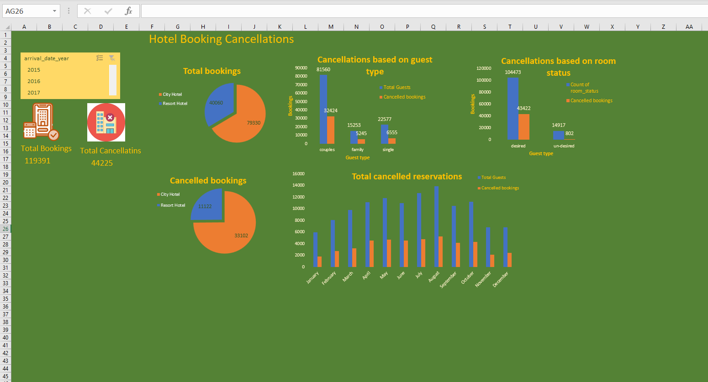

# 🏨 Hotel Booking Cancellations Analysis

An end-to-end data analysis project built in Microsoft Excel to analyze hotel booking cancellations, guest demographics, and reservation trends across different time periods.

---

## 📊 Dashboard Preview

---

## 📌 Project Overview

This project provides an interactive dashboard designed to explore and visualize key metrics related to hotel booking cancellations. It helps hoteliers and business analysts understand cancellation patterns based on hotel types, guest demographics, room statuses, and seasonal variations.

### Key Insights Explored:
- **Total vs. Cancelled Bookings:** Breakdown between City Hotel and Resort Hotel reservations[cite: 1].
- **Cancellations by Guest Type:** Analyzing cancellation ratios among couples, families, and single guests[cite: 1].
- **Room Status Analysis:** Comparing total vs. cancelled bookings across room status categories[cite: 1].
- **Monthly Reservation Trends:** Visualizing total cancelled reservations by month to identify high-cancellation periods[cite: 1].

---

## 📁 Repository Structure

| File Name | Description |
| :--- | :--- |
| `Hotel_Booking_Cancellations_Dashboard.xlsx` | Full interactive Excel workbook containing raw data, pivot tables, and dashboard[cite: 1, 2]. |
| `dashboard_preview.png.png` | High-resolution preview image of the final dashboard[cite: 2]. |
| `README.md` | Comprehensive documentation of the repository. |

---

## 🛠️ Tools & Excel Techniques Used

- **Microsoft Excel**
- **Data Aggregation:** Pivot Tables & Pivot Charts[cite: 1]
- **Dashboard Features:** Slicers (`arrival_date_year`), Custom Color Schemes, KPI Cards[cite: 1]
- **Data Visualization:** Pie Charts, Clustered Column Charts, Stacked Bar Charts[cite: 1]

---

## 🚀 How to Use

1. Click on `Hotel_Booking_Cancellations_Dashboard.xlsx` above to download the raw workbook[cite: 2].
2. Open the file in Microsoft Excel.
3. Navigate to the **Dashboard** sheet to interact with the year slicers and visual components[cite: 1].
